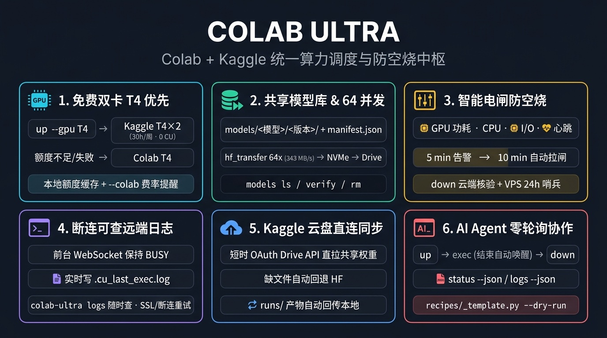

# Colab Ultra

在本机用一套命令启动 Google Colab 或 Kaggle、跑 Python 脚本、查看输出，并在任务结束后释放机器。

- **防空烧智能电闸**结合 GPU 功耗、CPU 活动、磁盘读写和任务心跳判断机器是否空闲。运行 `watch` 时，默认持续空闲 5 分钟告警，10 分钟自动关机。
- **免费双 T4 优先**。默认启动一台标准 T4 时，有 Kaggle 凭据和可用免费额度就先申请 Kaggle 双卡；申请失败自动回退到消耗计算单元（CU）的 Colab T4。
- **20 TB Drive 共享模型库**让多个项目复用一份权重。首次从 Hugging Face 或 HTTP 下载时，`hf_transfer` 默认用 64 路并发。可用容量取决于你的 Drive 账户。
- **断连后可查日志**。只要原会话还在，重新打开终端就能查看该会话最近一次 `exec` 的标准输出和错误输出，即使内核仍在忙。



## 3 分钟快速上手

在 Mac 上准备好 Python、uv 和 Google Cloud CLI（`gcloud`）。需要本地同步时，用 Google Drive for Desktop 登录同一 Google 账户。要用免费双卡，把 Kaggle API token 放在 `~/.kaggle/access_token`。

在仓库根目录安装。已有 `colab-ultra` 命令链接可跳过 `ln -s`。

```bash
uv tool install --with requests --with rich --with websocket-client google-colab-cli==0.7.5
mkdir -p ~/.local/bin
ln -s "$PWD/colab_ultra/breaker.py" ~/.local/bin/colab-ultra
export PATH="$HOME/.local/bin:$PATH"
colab-ultra init
```

按提示完成 Google 授权。`init` 检测到本地 Drive 后会同步运行库；要让 Kaggle 从 Drive 直接下载模型，可在初始化时用 `colab-ultra init --with-drive-scope`。

从仓库根目录逐条运行下面四条命令。自带的环境检查脚本会打印 Python 版本、GPU 和磁盘空间。

```bash
colab-ultra up -s demo
colab-ultra exec -s demo -f workflows/check_env.py
colab-ultra logs -s demo -n 20
colab-ultra down -s demo
```

长任务可在第二个终端运行 `logs`。每次 `exec` 会覆盖上一份日志，关机释放实例后日志也会消失。需要保留的结果写进项目的 `runs/`，确认已同步再关机。

## 常用命令

| 命令 | 用途 |
| --- | --- |
| `colab-ultra status` | 查看会话、负载和 CU 余额，加 `--json` 可供脚本读取。 |
| `colab-ultra up -s demo` | 启动会话。用 `--gpu L4` 指定显卡，或用 `--cpu` 处理数据。 |
| `colab-ultra exec -s demo -p tiles -f job.py` | 把本机脚本送到 VM，在项目 `tiles/code/` 中执行。 |
| `colab-ultra logs -s demo -n 100` | 读最近一次执行的末尾 100 行及当前任务名。`-n 0` 读全文，`--json` 输出结构化结果。 |
| `colab-ultra pull org/repo --dest models/my-model/bf16` | 用临时 CPU 会话预下载仓库到共享模型库，完成后释放机器。也支持单个 HF 或 HTTP 文件。 |
| `colab-ultra models ls` | 在本机列出模型版本、文件数、大小和清单状态。 |
| `colab-ultra models verify my-model/bf16` | 按清单核对文件名和大小，有问题时返回 1。省略版本可检查全库。 |
| `colab-ultra models rm my-model/bf16` | 预览将删除的版本，加 `--yes` 才执行。Drive 会同步这次删除。 |
| `colab-ultra down -s demo` | 关闭指定会话并核实资源已释放。 |
| `colab-ultra watch` | 在单独的终端持续巡检，按配置告警和关机。 |
| `colab-ultra sync-remote` | 将当前仓库的 `cu_remote` 更新到本地同步云盘的 `scripts/`。 |

## 费用与空闲保护

默认路由会检查 Kaggle 是否还有至少半小时免费 GPU 额度且无已预留时长。额度接口暂时不可用时，会参考本地缓存的余额和刷新时间。用 `--kaggle` 可以限定只用 Kaggle。用 `--colab` 强制走 Colab 时，若查到 Kaggle 还有可用额度，CLI 会提醒 Colab T4 的参考费用约为 **1.19 CU/小时**。

模型加载时 GPU 瓦数可能很低，`watch` 还会看近期心跳和 CPU、磁盘活动。任务长时间只发心跳又没有实际负载，仍可能触发关机。本机休眠期间要持续巡检，可配置独立 VPS 哨兵。

## 文件放在哪里

本机的 `~/ColabUltra/` 对应 Google Drive 的 `MyDrive/ColabUltra/`。Colab 将它挂在 `/content/drive/MyDrive/ColabUltra/`；Kaggle 在本机磁盘上模拟同一路径，按项目同步代码、输入和结果。

```text
~/ColabUltra/
├── models/                    所有项目共用
│   └── <模型>/<版本>/
│       ├── manifest.json      文件来源和字节数
│       └── …                  权重和配套文件
├── scripts/cu_remote/         VM 上可导入的 Python 运行库
└── <项目>/
    ├── code/                  推理脚本、prompts.json
    ├── data/                  输入数据
    └── runs/                  需要保留的输出
```

## 接入自己的推理脚本

以 `recipes/_template.py` 为起点，在模板的 `MODELS` 中填入模型、版本和文件来源，在 `infer(item, out_path)` 中加载本地权重并写出结果。例如，下面这条记录让模板准备一个编解码器权重文件。

```python
MODELS = [
    ("minimax-h3-image", "bf16", {
        "vae/diffusion_pytorch_model.safetensors":
            "hf://MiniMaxAI/MiniMax-H3-Image/vae/diffusion_pytorch_model.safetensors",
    }),
]
```

模板调用 `cu_remote.models.ensure(model, variant, files, to=MODEL_DIR / model / variant)`。返回值按相对文件名索引，每个值都是推理代码可直接打开的本地路径。Colab 从共享库暂存到 VM；已授权 Drive 的 Kaggle 先复用 VM 上的文件，再查 Drive，缺哪个文件就从它的原始地址下载。

把脚本存为 `recipes/my_infer.py`，把提示词放进 `~/ColabUltra/tiles/code/prompts.json`。先在本机检查计划，再在已启动的会话里执行。

```bash
H3_PROMPTS_JSON=~/ColabUltra/tiles/code/prompts.json python3 recipes/my_infer.py --dry-run
colab-ultra exec -s demo -p tiles -f recipes/my_infer.py
```

## 进阶文档

- 命令用法、计费与运行注意事项见 [SKILL.md](SKILL.md)。
- 模型命名、清单格式与旧权重迁移见[共享模型库](references/model-library.md)。
- 下载后端、VM 本地暂存和测速方法见 [NVMe 暂存指南](references/fast-nvme-staging.md)。
- 提示词 JSON 示例和可运行的推理脚本见 [recipes 使用说明](recipes/README.md)。
